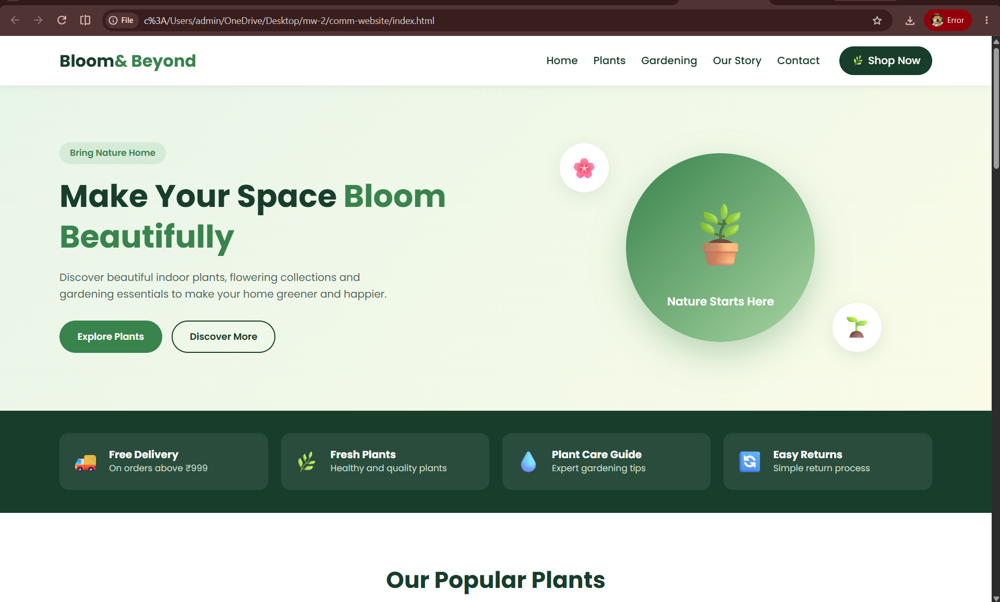
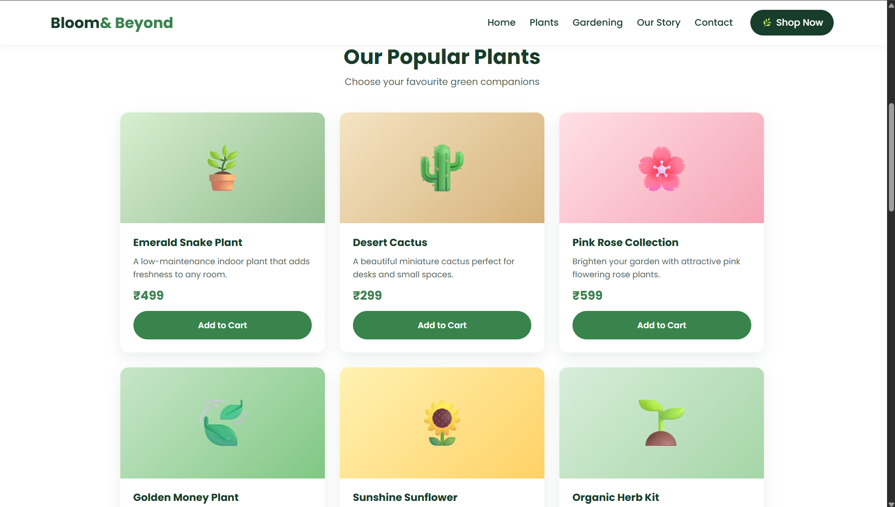
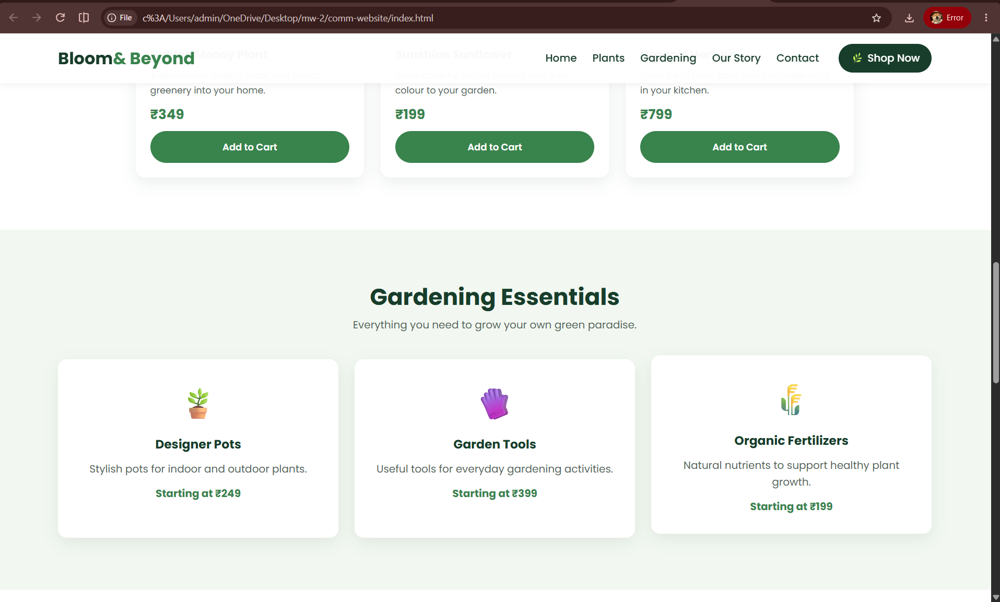
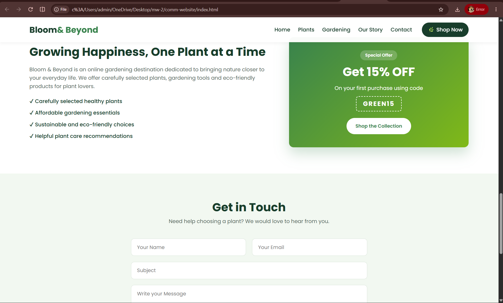

# Ex02 Commercial Website
## Date: 2/11/26

## AIM
To create a commercial website using CSS Flexbox.

## ALGORITHM
### STEP 1
Create an HTML file (index.html)

### STEP 2
Create a CSS file (style.css)

### STEP 3
Include a navigation bar with links to different sections.

### STEP 4
Add structured sections for Homepage, Products / Services, About Us, Contact Details and User Account.

### STEP 5
Include social media links at the footer with copyright information.

### STEP 6
Define global styles for fonts, colors, and layout.

### STEP 7
Style the header, navigation bar, and sections.

### STEP 8
Use Flexbox for layout design.

### STEP 9
Add hover effects and transitions for interactivity.

### STEP 10
Add Images and Media.

### STEP 11
Use optimized images for a professional look.

### STEP 12
Open the HTML file in a browser to check layout and functionality.

### STEP 13
Fix styling issues and refine content placement.

### STEP 14
Deploy the website.

### STEP 15
Upload to GitHub Pages for free hosting.

## PROGRAM
index.html
```

<!DOCTYPE html>
<html lang="en">
<head>
    <meta charset="UTF-8">
    <meta name="viewport" content="width=device-width, initial-scale=1.0">
    <title>Bloom & Beyond | Plant Store</title>

    <!-- Google Font -->
    <link rel="preconnect" href="https://fonts.googleapis.com">
    <link rel="preconnect" href="https://fonts.gstatic.com" crossorigin>
    <link href="https://fonts.googleapis.com/css2?family=Poppins:wght@400;500;600;700&display=swap" rel="stylesheet">

    <!-- CSS Connection -->
    <link rel="stylesheet" href="style.css">
</head>

<body>

    <!-- Header and Navigation -->
    <header class="header">
        <a href="#home" class="logo">Bloom<span>& Beyond</span></a>

        <nav class="nav">
            <ul class="nav-links">
                <li><a href="#home">Home</a></li>
                <li><a href="#plants">Plants</a></li>
                <li><a href="#gardening">Gardening</a></li>
                <li><a href="#about">Our Story</a></li>
                <li><a href="#contact">Contact</a></li>
            </ul>

            <a href="#plants" class="cart-btn">🌿 Shop Now</a>
        </nav>
    </header>

    <!-- Homepage / Hero Section -->
    <section id="home" class="hero">

        <div class="hero-text">
            <span class="hero-tag">Bring Nature Home</span>

            <h1>Make Your Space <span>Bloom Beautifully</span></h1>

            <p>
                Discover beautiful indoor plants, flowering collections
                and gardening essentials to make your home greener and happier.
            </p>

            <div class="hero-actions">
                <a href="#plants" class="btn btn-primary">Explore Plants</a>
                <a href="#about" class="btn btn-ghost">Discover More</a>
            </div>
        </div>

        <div class="hero-visual">
            <div class="plant-circle">
                <span>🪴</span>
                <p>Nature Starts Here</p>
            </div>

            <div class="bubble bubble-one">🌸</div>
            <div class="bubble bubble-two">🌱</div>
        </div>

    </section>

    <!-- Features Section -->
    <section class="features">

        <div class="feature">
            <span>🚚</span>
            <div>
                <h3>Free Delivery</h3>
                <p>On orders above ₹999</p>
            </div>
        </div>

        <div class="feature">
            <span>🌿</span>
            <div>
                <h3>Fresh Plants</h3>
                <p>Healthy and quality plants</p>
            </div>
        </div>

        <div class="feature">
            <span>💧</span>
            <div>
                <h3>Plant Care Guide</h3>
                <p>Expert gardening tips</p>
            </div>
        </div>

        <div class="feature">
            <span>🔄</span>
            <div>
                <h3>Easy Returns</h3>
                <p>Simple return process</p>
            </div>
        </div>

    </section>

    <!-- Products Section -->
    <section id="plants" class="products">

        <div class="section-head">
            <h2>Our Popular Plants</h2>
            <p>Choose your favourite green companions</p>
        </div>

        <div class="product-list">

            <article class="product-card">
                <div class="product-img img-1">🪴</div>
                <div class="product-body">
                    <h3>Emerald Snake Plant</h3>
                    <p>A low-maintenance indoor plant that adds freshness to any room.</p>
                    <span class="price">₹499</span>
                    <button class="btn btn-primary">Add to Cart</button>
                </div>
            </article>

            <article class="product-card">
                <div class="product-img img-2">🌵</div>
                <div class="product-body">
                    <h3>Desert Cactus</h3>
                    <p>A beautiful miniature cactus perfect for desks and small spaces.</p>
                    <span class="price">₹299</span>
                    <button class="btn btn-primary">Add to Cart</button>
                </div>
            </article>

            <article class="product-card">
                <div class="product-img img-3">🌸</div>
                <div class="product-body">
                    <h3>Pink Rose Collection</h3>
                    <p>Brighten your garden with attractive pink flowering rose plants.</p>
                    <span class="price">₹599</span>
                    <button class="btn btn-primary">Add to Cart</button>
                </div>
            </article>

            <article class="product-card">
                <div class="product-img img-4">🍃</div>
                <div class="product-body">
                    <h3>Golden Money Plant</h3>
                    <p>A decorative trailing plant that brings greenery into your home.</p>
                    <span class="price">₹349</span>
                    <button class="btn btn-primary">Add to Cart</button>
                </div>
            </article>

            <article class="product-card">
                <div class="product-img img-5">🌻</div>
                <div class="product-body">
                    <h3>Sunshine Sunflower</h3>
                    <p>Grow cheerful yellow flowers and add colour to your garden.</p>
                    <span class="price">₹199</span>
                    <button class="btn btn-primary">Add to Cart</button>
                </div>
            </article>

            <article class="product-card">
                <div class="product-img img-6">🌱</div>
                <div class="product-body">
                    <h3>Organic Herb Kit</h3>
                    <p>Grow fresh mint, basil and coriander right in your kitchen.</p>
                    <span class="price">₹799</span>
                    <button class="btn btn-primary">Add to Cart</button>
                </div>
            </article>

        </div>
    </section>

    <!-- Gardening Essentials -->
    <section id="gardening" class="gardening">

        <div class="section-head">
            <h2>Gardening Essentials</h2>
            <p>Everything you need to grow your own green paradise.</p>
        </div>

        <div class="garden-items">

            <div class="garden-card">
                <span>🪴</span>
                <h3>Designer Pots</h3>
                <p>Stylish pots for indoor and outdoor plants.</p>
                <strong>Starting at ₹249</strong>
            </div>

            <div class="garden-card">
                <span>🧤</span>
                <h3>Garden Tools</h3>
                <p>Useful tools for everyday gardening activities.</p>
                <strong>Starting at ₹399</strong>
            </div>

            <div class="garden-card">
                <span>🌾</span>
                <h3>Organic Fertilizers</h3>
                <p>Natural nutrients to support healthy plant growth.</p>
                <strong>Starting at ₹199</strong>
            </div>

        </div>
    </section>

    <!-- About Us -->
    <section id="about" class="about">

        <div class="about-text">
            <h2>Growing Happiness, One Plant at a Time</h2>

            <p>
                Bloom & Beyond is an online gardening destination
                dedicated to bringing nature closer to your everyday life.
                We offer carefully selected plants, gardening tools and
                eco-friendly products for plant lovers.
            </p>

            <ul class="about-points">
                <li>✔ Carefully selected healthy plants</li>
                <li>✔ Affordable gardening essentials</li>
                <li>✔ Sustainable and eco-friendly choices</li>
                <li>✔ Helpful plant care recommendations</li>
            </ul>
        </div>

        <div class="offer-box">
            <span class="offer-tag">Special Offer</span>
            <h3>Get 15% OFF</h3>
            <p>On your first purchase using code</p>
            <span class="offer-code">GREEN15</span>
            <a href="#plants" class="btn btn-light">Shop the Collection</a>
        </div>

    </section>

    <!-- Contact Section -->
    <section id="contact" class="contact">

        <div class="section-head">
            <h2>Get in Touch</h2>
            <p>Need help choosing a plant? We would love to hear from you.</p>
        </div>

        <form class="contact-form" action="#" onsubmit="return false;">

            <div class="form-row">
                <input type="text" placeholder="Your Name" required>
                <input type="email" placeholder="Your Email" required>
            </div>

            <input type="text" placeholder="Subject">

            <textarea rows="5" placeholder="Write your Message" required></textarea>

            <button type="submit" class="btn btn-primary">Send Message</button>

        </form>

    </section>

    <!-- Footer -->
    <footer class="footer">

        <div class="footer-cols">

            <div class="footer-col">
                <a href="#home" class="logo">Bloom<span>& Beyond</span></a>
                <p>
                    Making the world greener through beautiful plants,
                    sustainable products and gardening inspiration.
                </p>
            </div>

            <div class="footer-col">
                <h4>Explore</h4>
                <ul>
                    <li><a href="#home">Home</a></li>
                    <li><a href="#plants">Our Plants</a></li>
                    <li><a href="#gardening">Gardening Essentials</a></li>
                    <li><a href="#about">Our Story</a></li>
                </ul>
            </div>

            <div class="footer-col">
                <h4>Contact Details</h4>
                <ul>
                    <li>📍 Chennai, Tamil Nadu</li>
                    <li>📞 +91 9876543210</li>
                    <li>✉️ hello@bloomandbeyond.example</li>
                </ul>
            </div>

        </div>

        <div class="social-links">
            <a href="https://www.instagram.com/">Instagram</a>
            <a href="https://www.facebook.com/">Facebook</a>
            <a href="https://www.linkedin.com/">LinkedIn</a>
        </div>

        <div class="footer-bottom">
            <p>
                Designed by Jayasree T S |
                Register No: 212224040135 |
                &copy; 2026 All Rights Reserved.
            </p>
        </div>

    </footer>

</body>
</html>

```
style.css

```

/* ===== Global Styles ===== */

:root {
    --primary: #39834d;
    --primary-dark: #28643a;
    --dark: #183d2b;
    --text: #53665a;
    --light: #f2f8f1;
    --white: #ffffff;
    --radius: 14px;
    --shadow: 0 8px 24px rgba(24, 61, 43, 0.09);
}

* {
    margin: 0;
    padding: 0;
    box-sizing: border-box;
}

html {
    scroll-behavior: smooth;
    scroll-padding-top: 80px;
}

body {
    font-family: "Poppins", sans-serif;
    color: var(--text);
    background: var(--white);
    line-height: 1.6;
}

a {
    text-decoration: none;
    color: inherit;
}

ul {
    list-style: none;
}

h1, h2, h3, h4 {
    color: var(--dark);
    line-height: 1.3;
}

/* ===== Buttons ===== */

.btn {
    display: inline-flex;
    justify-content: center;
    align-items: center;
    padding: 12px 26px;
    border: 2px solid transparent;
    border-radius: 50px;
    font-family: inherit;
    font-size: 0.9rem;
    font-weight: 600;
    cursor: pointer;
    transition: 0.3s;
}

.btn:hover {
    transform: translateY(-3px);
}

.btn-primary {
    background: var(--primary);
    color: var(--white);
}

.btn-primary:hover {
    background: var(--primary-dark);
    box-shadow: 0 8px 20px rgba(57, 131, 77, 0.3);
}

.btn-ghost {
    border-color: var(--dark);
    color: var(--dark);
}

.btn-ghost:hover {
    background: var(--dark);
    color: var(--white);
}

.btn-light {
    background: var(--white);
    color: var(--primary);
}

/* ===== Header and Navigation ===== */

.header {
    position: sticky;
    top: 0;
    z-index: 100;
    display: flex;
    justify-content: space-between;
    align-items: center;
    padding: 16px 6%;
    background: rgba(255, 255, 255, 0.97);
    box-shadow: 0 2px 12px rgba(0, 0, 0, 0.06);
}

.logo {
    font-size: 1.6rem;
    font-weight: 700;
    color: var(--dark);
}

.logo span {
    color: var(--primary);
}

.nav {
    display: flex;
    align-items: center;
    gap: 30px;
}

.nav-links {
    display: flex;
    gap: 24px;
}

.nav-links a {
    font-weight: 500;
    color: var(--dark);
    transition: 0.3s;
}

.nav-links a:hover {
    color: var(--primary);
}

.cart-btn {
    padding: 9px 18px;
    border-radius: 50px;
    background: var(--dark);
    color: var(--white);
    font-weight: 500;
}

.cart-btn:hover {
    background: var(--primary);
}

/* ===== Hero Section ===== */

.hero {
    display: flex;
    justify-content: space-between;
    align-items: center;
    gap: 40px;
    padding: 80px 6%;
    background: linear-gradient(135deg, #e8f5e9, #f9fbe7);
}

.hero-text {
    flex: 1;
}

.hero-tag {
    display: inline-block;
    padding: 6px 16px;
    margin-bottom: 18px;
    border-radius: 50px;
    background: #d6ead8;
    color: var(--primary);
    font-size: 0.85rem;
    font-weight: 600;
}

.hero h1 {
    font-size: 3rem;
    margin-bottom: 18px;
}

.hero h1 span {
    color: var(--primary);
}

.hero-text p {
    max-width: 520px;
    margin-bottom: 28px;
}

.hero-actions {
    display: flex;
    flex-wrap: wrap;
    gap: 15px;
}

/* Hero Visual */

.hero-visual {
    flex: 1;
    display: flex;
    justify-content: center;
    align-items: center;
    position: relative;
    min-height: 340px;
}

.plant-circle {
    display: flex;
    flex-direction: column;
    justify-content: center;
    align-items: center;
    gap: 12px;
    width: 290px;
    height: 290px;
    border-radius: 50%;
    background: linear-gradient(135deg, #39834d, #a8d5a2);
    color: white;
    box-shadow: 0 20px 50px rgba(57, 131, 77, 0.3);
}

.plant-circle span {
    font-size: 6rem;
}

.plant-circle p {
    font-size: 1.1rem;
    font-weight: 600;
}

.bubble {
    position: absolute;
    display: flex;
    justify-content: center;
    align-items: center;
    width: 75px;
    height: 75px;
    border-radius: 50%;
    background: white;
    box-shadow: var(--shadow);
    font-size: 2rem;
}

.bubble-one {
    top: 10px;
    left: 12%;
}

.bubble-two {
    bottom: 10px;
    right: 12%;
}

/* ===== Features ===== */

.features {
    display: flex;
    flex-wrap: wrap;
    gap: 20px;
    padding: 35px 6%;
    background: var(--dark);
}

.feature {
    flex: 1 1 200px;
    display: flex;
    align-items: center;
    gap: 14px;
    padding: 18px;
    border-radius: var(--radius);
    background: rgba(255, 255, 255, 0.08);
    transition: 0.3s;
}

.feature:hover {
    background: rgba(255, 255, 255, 0.17);
    transform: translateY(-4px);
}

.feature span {
    font-size: 2rem;
}

.feature h3 {
    color: white;
    font-size: 1rem;
}

.feature p {
    color: #c9dfce;
    font-size: 0.85rem;
}

/* ===== Section Headings ===== */

.section-head {
    display: flex;
    flex-direction: column;
    align-items: center;
    gap: 7px;
    margin-bottom: 40px;
    text-align: center;
}

.section-head h2 {
    font-size: 2.2rem;
    color: var(--dark);
}

/* ===== Products Section ===== */

.products {
    padding: 80px 6%;
}

.product-list {
    display: flex;
    flex-wrap: wrap;
    gap: 26px;
    max-width: 1100px;
    margin: 0 auto;
}

.product-card {
    flex: 1 1 280px;
    display: flex;
    flex-direction: column;
    overflow: hidden;
    border-radius: var(--radius);
    background: white;
    box-shadow: var(--shadow);
    transition: 0.3s;
}

.product-card:hover {
    transform: translateY(-8px);
    box-shadow: 0 18px 40px rgba(24, 61, 43, 0.15);
}

.product-img {
    display: flex;
    justify-content: center;
    align-items: center;
    height: 190px;
    font-size: 5rem;
    transition: 0.3s;
}

.product-card:hover .product-img {
    transform: scale(1.05);
}

.img-1 {
    background: linear-gradient(135deg, #d8efcf, #8fbc8f);
}

.img-2 {
    background: linear-gradient(135deg, #f5e4c3, #d5b17a);
}

.img-3 {
    background: linear-gradient(135deg, #ffe0e6, #f5a4b5);
}

.img-4 {
    background: linear-gradient(135deg, #c8e6c9, #81c784);
}

.img-5 {
    background: linear-gradient(135deg, #fff2b2, #ffd166);
}

.img-6 {
    background: linear-gradient(135deg, #d8edda, #a5d6a7);
}

.product-body {
    flex: 1;
    display: flex;
    flex-direction: column;
    gap: 9px;
    padding: 22px;
}

.product-body h3 {
    font-size: 1.1rem;
}

.product-body p {
    font-size: 0.88rem;
}

.price {
    font-size: 1.3rem;
    font-weight: 700;
    color: var(--primary);
}

.product-body .btn {
    margin-top: auto;
}

/* ===== Gardening Essentials ===== */

.gardening {
    padding: 80px 6%;
    background: var(--light);
}

.garden-items {
    display: flex;
    flex-wrap: wrap;
    justify-content: center;
    gap: 25px;
}

.garden-card {
    flex: 1 1 250px;
    display: flex;
    flex-direction: column;
    align-items: center;
    gap: 12px;
    padding: 30px 22px;
    border-radius: var(--radius);
    background: white;
    box-shadow: var(--shadow);
    text-align: center;
    transition: 0.3s;
}

.garden-card:hover {
    transform: translateY(-6px);
}

.garden-card span {
    font-size: 3rem;
}

.garden-card strong {
    color: var(--primary);
}

/* ===== About Section ===== */

.about {
    display: flex;
    align-items: center;
    gap: 45px;
    padding: 80px 6%;
}

.about-text {
    flex: 3;
}

.about-text h2 {
    font-size: 2.2rem;
    margin-bottom: 18px;
}

.about-text p {
    margin-bottom: 20px;
}

.about-points {
    display: flex;
    flex-direction: column;
    gap: 10px;
    font-weight: 500;
    color: var(--dark);
}

.offer-box {
    flex: 2;
    display: flex;
    flex-direction: column;
    align-items: center;
    gap: 12px;
    padding: 40px 25px;
    border-radius: var(--radius);
    background: linear-gradient(135deg, #39834d, #80b918);
    color: white;
    text-align: center;
    box-shadow: 0 18px 40px rgba(57, 131, 77, 0.25);
}

.offer-tag {
    padding: 5px 15px;
    border-radius: 50px;
    background: rgba(255, 255, 255, 0.2);
    font-size: 0.8rem;
    font-weight: 600;
}

.offer-box h3 {
    color: white;
    font-size: 2.3rem;
}

.offer-code {
    margin-bottom: 8px;
    padding: 6px 20px;
    border: 2px dashed white;
    border-radius: 8px;
    font-size: 1.2rem;
    font-weight: 700;
    letter-spacing: 2px;
}

/* ===== Contact Section ===== */

.contact {
    padding: 80px 6%;
    background: var(--light);
}

.contact-form {
    display: flex;
    flex-direction: column;
    gap: 18px;
    max-width: 720px;
    margin: 0 auto;
}

.form-row {
    display: flex;
    gap: 18px;
}

.form-row input {
    flex: 1;
}

.contact-form input,
.contact-form textarea {
    width: 100%;
    padding: 14px 18px;
    border: 1px solid #d6e2d6;
    border-radius: 10px;
    font-family: inherit;
    font-size: 0.95rem;
}

.contact-form input:focus,
.contact-form textarea:focus {
    outline: none;
    border-color: var(--primary);
    box-shadow: 0 0 0 3px rgba(57, 131, 77, 0.15);
}

.contact-form textarea {
    resize: vertical;
}

.contact-form .btn {
    align-self: flex-start;
}

/* ===== Footer ===== */

.footer {
    background: var(--dark);
    color: #c9dfce;
}

.footer-cols {
    display: flex;
    justify-content: space-between;
    gap: 40px;
    padding: 55px 6% 30px;
}

.footer-col {
    flex: 1;
    display: flex;
    flex-direction: column;
    gap: 14px;
}

.footer-col .logo {
    color: white;
}

.footer-col h4 {
    color: white;
    font-size: 1.1rem;
}

.footer-col ul {
    display: flex;
    flex-direction: column;
    gap: 8px;
}

.footer-col a:hover {
    color: #8ed69b;
}

.social-links {
    display: flex;
    justify-content: center;
    flex-wrap: wrap;
    gap: 25px;
    padding: 20px;
}

.social-links a {
    color: white;
    transition: 0.3s;
}

.social-links a:hover {
    color: #8ed69b;
}

.footer-bottom {
    display: flex;
    justify-content: center;
    padding: 20px 6%;
    border-top: 1px solid rgba(255, 255, 255, 0.15);
    font-size: 0.85rem;
    text-align: center;
    color: white;
}

/* ===== Responsive Design ===== */

@media (max-width: 992px) {

    .hero h1 {
        font-size: 2.5rem;
    }

    .features {
        flex-wrap: wrap;
    }

    .about {
        flex-direction: column;
        align-items: stretch;
    }
}

@media (max-width: 768px) {

    .header {
        flex-direction: column;
        gap: 15px;
    }

    .nav {
        flex-wrap: wrap;
        justify-content: center;
        gap: 15px;
    }

    .nav-links {
        flex-wrap: wrap;
        justify-content: center;
        gap: 15px;
    }

    .hero {
        flex-direction: column;
        text-align: center;
        padding: 50px 6%;
    }

    .hero-text p {
        margin-left: auto;
        margin-right: auto;
    }

    .hero-actions {
        justify-content: center;
    }

    .hero-visual {
        width: 100%;
        min-height: 300px;
    }

    .plant-circle {
        width: 240px;
        height: 240px;
    }

    .plant-circle span {
        font-size: 4.5rem;
    }

    .footer-cols {
        flex-direction: column;
        gap: 30px;
    }

    .section-head h2,
    .about-text h2 {
        font-size: 1.8rem;
    }
}

@media (max-width: 480px) {

    .logo {
        font-size: 1.3rem;
    }

    .hero h1 {
        font-size: 2rem;
    }

    .hero-actions {
        flex-direction: column;
    }

    .bubble {
        width: 60px;
        height: 60px;
        font-size: 1.5rem;
    }

    .bubble-one {
        left: 3%;
    }

    .bubble-two {
        right: 3%;
    }

    .features {
        flex-direction: column;
    }

    .form-row {
        flex-direction: column;
    }

    .contact-form .btn {
        align-self: stretch;
    }

    .offer-box h3 {
        font-size: 2rem;
    }

    .footer-bottom {
        font-size: 0.75rem;
    }
}


```

## OUTPUT




 

## RESULT
The program for creating commercial website using CSS Flexbox is executed successfully.